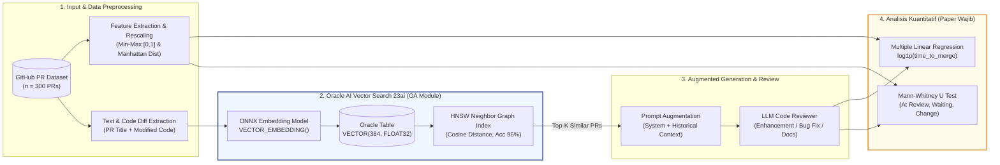
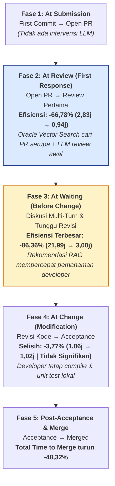

# Eksperimen Kuantitatif: LLM Code Review dengan Oracle AI Vector Search 23ai

**Tugas UAS:** LLM - Code Review - Mandiri  
**Mahasiswa:** Muhammad Hafizh Ramadhan  
**NIM:** 12409011030031  
**Program Studi:** Teknik Informatika  
**Akses repositori:** Permintaan berbagi akses untuk `rizalbroer@uinjkt.ac.id`. Undangan akses harus dikirim melalui pengaturan repositori GitHub oleh pemilik repositori; dokumentasi ini tidak mengirim undangan.

## Ringkasan dan metode ATM

Proyek ini menerapkan metode **Amati-Tiru-Modifikasi (ATM)** pada proses code review berbantuan LLM. Tahap *Amati* mengacu pada Collante et al. (2025), *The Impact of Large Language Models (LLMs) on Code Review Process* ([arXiv:2508.11034](https://arxiv.org/abs/2508.11034)), yang membahas perubahan durasi pada fase-fase siklus review. Tahap *Tiru* mengoperasionalkan perbandingan waktu melalui data PR simulasi, regresi linear berganda, dan uji Mann–Whitney U. Tahap *Modifikasi* menambahkan konsep Oracle AI Vector Search 23ai: embedding ONNX, indeks HNSW, pencarian PR serupa, dan augmentasi konteks RAG.

**Research gap dan novelty yang diuji:** eksperimen ini mengusulkan penghubung eksplisit antara pencarian konteks PR historis berbasis vector search Oracle 23ai dan metrik kuantitatif per fase code review. Angka dan hasil di repositori ini berasal dari **simulasi terkontrol**, bukan reproduksi data atau temuan empiris paper. Simulasi mengatur penurunan rata-rata fase review sekitar 66,78%, waktu tunggu sebelum perubahan 86,36%, dan total waktu hingga merge 48,32%; fase perubahan kode hanya sekitar 3,77%. Klaim novelty adalah motivasi/hipotesis rancangan yang perlu diuji dengan data nyata, bukan klaim bahwa integrasi Oracle telah dijalankan atau tervalidasi secara empiris.

### Variabel dataset

| Variabel | Definisi |
|---|---|
| `pr_id` | ID PR sintetis. |
| `is_rag_assisted` | Indikator perlakuan: `1` RAG-assisted, `0` non-assisted. |
| `project_age_month` | Usia proyek dalam bulan. |
| `no_commits` | Jumlah commit pada PR. |
| `PR_size` | Ukuran perubahan sintetis (baris perubahan). |
| `no_changed_files` | Jumlah file yang berubah. |
| `at_submission_h` | Durasi dari commit pertama sampai PR dibuka, dalam jam. |
| `at_review_h` | Durasi sampai respons review pertama, dalam jam. |
| `at_waiting_change_h` | Waktu diskusi dan menunggu revisi, dalam jam. |
| `at_change_h` | Waktu revisi kode hingga diterima, dalam jam. |
| `at_waiting_after_h` | Waktu setelah acceptance sampai merge, dalam jam. |
| `time_to_merge_h` | Total durasi semua fase di atas, dalam jam. |
| `vector_cosine_sim` | Similarity cosine contoh hasil retrieval; kosong untuk kontrol non-RAG. |
| `manhattan_match_dist` | Jarak Manhattan ke PR terdekat dari kelompok perlakuan berlawanan setelah fitur kontrol dinormalisasi. |
| `task_*` | Kategori tugas code review per fase: Enhancement, Bug Fix, Documentation, Implementation, Testing, atau Other. |

### Diagram 1: Arsitektur Pipeline (Oracle AI Vector Search + RAG Code Review)



### Diagram 2: Alur Siklus Hidup PR & Titik Intervensi RAG



## Struktur proyek

```text
.
├── data/
│   └── pr_dataset.csv                 # Dibuat oleh generator
├── outputs/                           # Laporan statistik dan grafik
├── prompts/
│   └── code_review_prompts.md
├── sql/
│   └── oracle_23ai_vector_rag.sql
├── src/
│   ├── generate_dataset.py
│   └── run_experiment.py
└── requirements.txt
```

## Menjalankan eksperimen

Gunakan Python 3.10+ dari direktori repositori:

```bash
python -m pip install -r requirements.txt
python src/generate_dataset.py
python src/run_experiment.py
```

Generator membuat 300 baris simulasi seimbang (150 per kelompok) dengan seed 42. Analisis menghasilkan `outputs/regression_summary.txt`, `outputs/mann_whitney_results.csv`, `outputs/task_category_counts.csv`, `outputs/manhattan_matching_summary.txt`, serta tiga grafik PNG 300 DPI. Skrip SQL adalah contoh implementasi untuk Oracle Database 23ai dan memerlukan tabel, model embedding ONNX `ALL_MINILM_L6_V2`, serta akses database yang sesuai; SQL tidak dijalankan oleh eksperimen Python lokal.

## Referensi

- Collante et al. (2025). [The Impact of Large Language Models (LLMs) on Code Review Process](https://arxiv.org/abs/2508.11034). arXiv:2508.11034.
- Oracle Academy. *Introduction to Vector Search with Oracle Database 23ai* (materi pembelajaran Oracle Academy).
